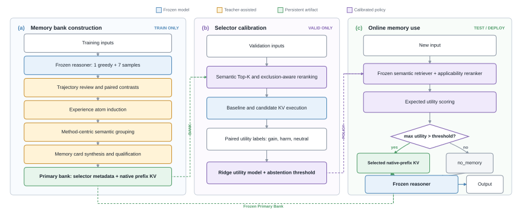
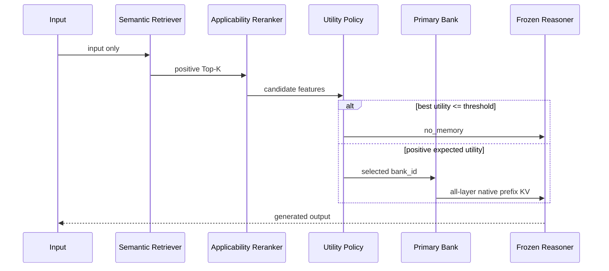

# MemGen V5：方法设计与系统实现

## 摘要

MemGen V5 面向参数冻结的语言模型，目标是从历史求解轨迹中构造可复用的经验记忆，并在新输入到来时选择一张合适的记忆卡辅助推理。系统不更新 Reasoner 参数，而是将 Memory Card 离线编译为原生前缀键值缓存（native prefix KV）。在线阶段仅依据当前输入选择一张 Primary Bank，或选择 `no_memory`，随后由冻结 Reasoner 完成生成。

V5 包含三个部分：训练集上的离线 Bank 构造、验证集上的 Selector 校准，以及测试或部署阶段的冻结在线推理。Bank 构造采用“Episode—Contrast—Experience Atom—Method Group—Memory Card”的逐级抽象过程；Selector 采用“正向语义召回—排除条件感知重排—期望效用预测”的三级决策过程。

---

## 1. 系统定义

给定冻结 Reasoner $f_\theta$，V5 从训练集构造记忆库：

$$
\mathcal{B}=\{B_1,B_2,\ldots,B_N\}.
$$

对新输入 $x$，Selector 只允许输出一张 Bank 或不使用记忆：

$$
\pi(x)\in\{\varnothing,1,2,\ldots,N\},
$$

其中 $\varnothing$ 表示 `no_memory`。若选择 $B_i$，系统在题目 prefill 前加载该 Bank 的全层 native prefix KV，再由同一个冻结 Reasoner 生成答案。

V5 的固定约束为：

- Reasoner 参数始终冻结；
- Train 用于 Rollout 和 Bank 构造；
- Valid 用于 Selector 的效用测量、拟合和阈值校准；
- Test 只用于冻结系统的最终评估；
- Selector 只能访问当前输入；
- 在线只使用 Primary Bank；
- 每个输入至多消费一张 Memory Card；
- 允许 `no_memory`；
- 在线阶段不调用 Qwen3-32B 教师模型。

---

## 2. 总体方法



**图 1　MemGen V5 三阶段方法。** （a）Bank Construction 在 Train 上完成轨迹采集、对照经验归纳、方法分组、Memory Card 构造与 native prefix KV 编译；（b）Selector Calibration 在 Valid 上执行候选检索、配对分支评估和 Utility/Abstention 校准；（c）Online Memory Use 在 Test 或部署阶段仅依据输入选择一张 Primary Bank 或 `no_memory`，并由冻结 Reasoner 完成生成。实线表示阶段内数据流，虚线表示跨阶段复用的冻结 Bank 与 Selector Policy。蓝色、黄色、绿色和紫色分别表示冻结模型、教师辅助操作、持久化记忆产物和校准策略。

论文排版可直接使用矢量版本 [SVG](figures/v5_three_stage_method.svg) 或 [PDF](figures/v5_three_stage_method.pdf)；演示文稿和网页可使用 [PNG](figures/v5_three_stage_method.png)。绘图源代码位于 `scripts/figures/render_v5_method_figure.py`。

一张可在线使用的 Bank 表示为：

$$
B_i=\left(k_i^+,e_i,m_i,\{K_i^{(l)},V_i^{(l)}\}_{l=1}^{L}\right),
$$

其中：

- $k_i^+$：正向、输入可观察的 Selector Key；
- $e_i$：独立保存的排除条件；
- $m_i$：完整 Memory Card；
- $K_i^{(l)},V_i^{(l)}$：第 $l$ 层的原生前缀 KV。

Selector Key 用于选择 Bank；native prefix KV 是 Reasoner 实际消费的记忆。二者在系统中分别构造和保存。

---

## 3. 离线 Bank 构造

### 3.1 Rollout 采集

每个 Train 输入固定生成 8 条轨迹：

```yaml
greedy_rollouts: 1
sampled_rollouts: 7
temperature: 0.8
top_p: 0.95
top_k: 0
max_new_tokens: 1024
```

该阶段只使用冻结 Reasoner，不加载教师模型。每条轨迹保存为统一 Episode：

```text
Episode = {
    input,
    output,
    generation metadata,
    verifier outcome,
    provenance
}
```

不同任务只负责数据读取、Reasoner prompt 和结果 verifier；后续记忆构造使用统一实现。当前生产代码只注册了 GSM8K Task Protocol，接入新任务时需要新增任务协议，但不修改 Atom、Grouping、Card、Selector 或 KV 编译模块。

### 3.2 轨迹审查与 Contrast

非截断 Episode 同时接受：

1. 任务 Verifier 的答案与格式检查；
2. Qwen3-32B 的推理过程检查。

轨迹被分为：

| 状态 | 判定条件 |
|---|---|
| `success` | 答案正确、格式正确、未截断且过程正确 |
| `failure` | 存在答案错误、过程错误或格式错误 |
| `uncertain` | Verifier 与教师冲突，或教师无法确定 |
| `truncated` | 达到长度上限或由长度限制终止 |

`truncated` 不作为成功或失败。

对同一输入，系统选择一条可靠成功轨迹，并分别寻找答案错误、过程错误和格式错误轨迹。每个输入最多形成 3 个 Contrast：

$$
C=(x,y^+,y^-,f,r^+,r^-),
$$

其中 $y^+$ 与 $y^-$ 分别为成功和失败输出，$f$ 为主要失败类型，$r^+$ 与 $r^-$ 为过程审查结果。没有可靠成功—失败对的输入不产生 Contrast。

### 3.3 Experience Atom

Qwen3-32B 比较同一输入上的成功和失败轨迹，提取最小可迁移经验单元：

```text
Experience Atom
├── applicability
│   ├── task_goal
│   ├── problem_structure
│   ├── observable_cues
│   └── required_operation
├── experience
│   ├── do
│   ├── avoid
│   ├── why
│   ├── verify
│   └── runtime_limits
├── exclusions_from_input
├── failure_mechanism
├── transferable
└── confidence
```

可接受的 Atom 必须描述可执行操作、输入可观察的适用条件、失败机制和验证方式，而不是复述原题内容或答案。

代码只验证 JSON 结构、字段类型、枚举和 ID 覆盖；经验是否泛化、是否过度概括由教师模型进行语义判断。

### 3.4 按共同方法分组

Grouping 按“共同求解方法”聚合 Atom，而不是按题目表面主题聚类：

1. Qwen3-32B 对小批量 Atom 进行局部方法划分；
2. 冻结 Reasoner 编码 Group 摘要并召回近邻候选；
3. Qwen3-32B 判断候选 pair 是否为 `same_method`；
4. 只有适用条件兼容且 exclusions 不冲突的 pair 才建立边；
5. 教师执行 cluster edge audit，移除链式错误合并；
6. 程序在审核后的图上计算最终连通分量。

程序负责正式 ID、覆盖、去重和 provenance；教师只负责语义判断。协议失败的 Atom 会以 `protocol_fallback` singleton 保存，但不能晋升为 Primary。

### 3.5 Memory Card 与 Primary 资格

Group 通过平衡树式摘要生成 Memory Card，避免顺序式合并遗忘早期信息。Card 包含：

```text
selector_key
├── task_goal
├── problem_structure
├── observable_cues
├── required_operation
└── exclusions_from_input

memory_payload
├── applicability_summary
├── method
├── avoid
├── rationale
├── verification
└── runtime_limits
```

Card 只有同时满足以下条件才成为 Primary：

```yaml
minimum_distinct_train_inputs: 3
teacher_quality_tier: primary
coherent: true
executable: true
input_observable_key: true
contradiction_free: true
protocol_fallback: false
```

Conditional 和 Reject Card 仅保留用于审计，不进入在线 Bank。

### 3.6 编译为 native prefix KV

完整 Primary Card 以固定模板序列化，包含适用条件、推荐方法、应避免行为、原因、验证步骤和运行限制。冻结 Reasoner 对其执行一次离线前向：

$$
\{K_i^{(l)},V_i^{(l)}\}_{l=1}^{L}
=
\operatorname{ReasonerPrefix}
\left(\operatorname{Tokenize}(m_i)\right).
$$

每张 Bank 保存全层 KV tensor、prefix token IDs、Card hash、模型 profile 和文件 hash。

同时，系统只对正向 Selector Key 编码检索向量。`exclusions_from_input` 不进入向量，而是在 Reranker 阶段单独使用。

---

## 4. Selector 校准

### 4.1 正向语义召回

冻结 Reasoner Encoder 编码输入和正向 Selector Key：

$$
s_{sem}(x,B_i)=\cos\left(E(x),E(k_i^+)\right).
$$

默认保留 Top-5 候选。该步骤只负责候选召回。

### 4.2 排除条件感知重排

Qwen3-Reranker-8B 接收当前输入、正向 Selector Key 和独立 exclusions，输出适用性分数 $s_{app}(x,B_i)$。该分数判断方法是否适用，不直接表示最终答题成功率。

### 4.3 配对效用测量

对每个 Valid 输入，系统先冻结 Top-K 候选，再分别运行无记忆 baseline 和每张候选 Bank。候选效用定义为：

$$
u(x,B_i)=
\mathbb{1}[c_i(x)=1\land c_0(x)=0]
-
\mathbb{1}[c_i(x)=0\land c_0(x)=1].
$$

| Baseline | Memory | Utility |
|---|---|---:|
| 错 | 对 | +1 |
| 对 | 错 | -1 |
| 对 | 对 | 0 |
| 错 | 错 | 0 |

### 4.4 Utility Model 与弃权

当前实现使用 Ridge Regression：

$$
\hat u(x,B_i)=w^\top\phi(x,B_i),
$$

其中输入特征包括：

```text
semantic similarity
reranker applicability
semantic top margin
log(1 + distinct input support)
semantic × reranker
```

系统选择预测效用最高的候选。若最高分不超过 Valid 上校准的阈值 $\tau$，则返回 `no_memory`。校准阶段执行五折 out-of-fold 评估，并在全部 Valid 上重拟合最终冻结策略。

---

## 5. 在线推理



在线执行顺序为：

1. 输入召回正向语义 Top-K；
2. Reranker 根据适用条件和 exclusions 重排；
3. Utility Model 预测候选效用；
4. 选择一张 Primary Bank 或 `no_memory`；
5. 若选择 Bank，则在题目 prefill 前加载全层 native prefix KV；
6. 冻结 Reasoner 生成答案。

Top-K 只用于候选选择，不会同时消费多张 Card。在线阶段不会重新生成 Card，也不会访问训练轨迹、标准答案或教师模型。

---

## 6. 工程实现

### 6.1 两阶段运行

生产流程拆为两个独立阶段：

```text
Phase 1: split → episodes

Phase 2: split → review → contrasts → atoms → groups
               → cards → compile → calibrate
```

Phase 1 只采集 Rollout；Phase 2 复用 Episode，加载教师模型完成 Bank 构造，并在最后加载 Reranker 和 Reasoner 完成 Selector 校准。两阶段拆分便于独立设置 batch size、GPU 和教师并发度。

### 6.2 核心模块

| 文件 | 职责 |
|---|---|
| `task.py` | 数据划分、任务 prompt、verifier 和 Episode 协议 |
| `rollouts.py` | 批量轨迹采集 |
| `review.py` / `contrasts.py` | 轨迹分类与成功—失败对照 |
| `atoms.py` | Experience Atom 提取 |
| `grouping.py` | 方法分组、候选图和 cluster audit |
| `cards.py` | Card 构造与 Primary 资格审查 |
| `compilation.py` / `prefix.py` | 检索索引与 native prefix KV |
| `calibration.py` / `selector.py` | Valid 效用测量和 Selector 校准 |
| `online.py` / `evaluation.py` | 在线推理与冻结评估 |
| `schemas.py` / `audit.py` | 协议验证和完整性审计 |
| `pipeline.py` | 阶段编排与模型生命周期管理 |

### 6.3 关键默认参数

| 参数 | 默认值 |
|---|---:|
| Reasoner | `Qwen/Qwen2.5-1.5B-Instruct` |
| Teacher | `Qwen/Qwen3-32B` |
| Reranker | `Qwen/Qwen3-Reranker-8B` |
| Rollouts per input | 8 |
| Rollout batch size | 32 |
| Teacher concurrency | 16 |
| Contrast limit per input | 3 |
| Group candidate Top-K | 32 |
| Card leaf size | 16 |
| Minimum Primary support | 3 inputs |
| Selector Top-K | 5 |
| Utility OOF folds | 5 |

### 6.4 服务器命令

采集 Rollout：

```bash
CUDA_VISIBLE_DEVICES=0 bash scripts/experiments/gsm8k/run_v5_memory.sh \
  --phase rollouts \
  --config configs/experiments/gsm8k/v5.json \
  --output-dir output/experiments/v5/rollouts/gsm8k-r1 \
  --rollout-batch-size 32
```

启动四卡 Qwen3-32B 教师服务：

```bash
PATH="$PWD/.venv-vllm/bin:$PATH" \
  .venv-vllm/bin/python scripts/serve_v5_teacher.py \
  --config configs/experiments/gsm8k/v5.json \
  --gpus 0,1,2,3 \
  --max-num-seqs 32 \
  --gpu-memory-utilization 0.8
```

构造 Bank 并校准 Selector：

```bash
CUDA_VISIBLE_DEVICES=4 bash scripts/experiments/gsm8k/run_v5_memory.sh \
  --phase bank \
  --config configs/experiments/gsm8k/v5.json \
  --rollout-source output/experiments/v5/rollouts/gsm8k-r1 \
  --output-dir output/experiments/v5/banks/gsm8k-r1 \
  --teacher-concurrency 16
```

运行冻结 Test：

```bash
CUDA_VISIBLE_DEVICES=0 python scripts/evaluate_v5_memory.py \
  --bank-dir output/experiments/v5/banks/gsm8k-r1 \
  --output-dir output/experiments/v5/evaluation/gsm8k-test-r1 \
  --split test
```

### 6.5 可恢复性与完整性

每个运行目录绑定数据集、模型 revision、配置、代码 revision、运行环境和上游产物 hash。阶段产物不可覆盖，并支持在相同身份下使用 `--resume` 恢复。

如果 prompt、Schema、模型、代码或配置发生变化，应使用新的输出目录。`--stage` 只用于单阶段故障恢复；正常流程使用 `--phase rollouts` 和 `--phase bank`。

---

## 7. 总结

MemGen V5 的方法可以概括为：

1. 对 Train 输入生成多条冻结 Reasoner 轨迹；
2. 从同输入成功—失败对照中提取可迁移 Experience Atom；
3. 按共同求解方法归并 Atom 并构造 Memory Card；
4. 仅将支持充分、语义合格且无协议回退的 Card 晋升为 Primary；
5. 将完整 Primary Card 编译为全层 native prefix KV；
6. 在 Valid 上校准语义召回、排除条件重排和 Utility/Abstention 策略；
7. 在线仅依据输入选择一张 Primary Bank 或 `no_memory`；
8. 在题目推理开始前加载 KV，由冻结 Reasoner 完成生成。

V5 将三个职责明确分离：Bank 构造负责经验内容，Selector 负责判断条件效用，native prefix KV 负责把选中的经验交给冻结 Reasoner 消费。
