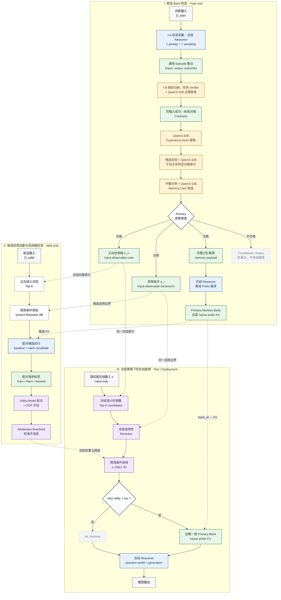
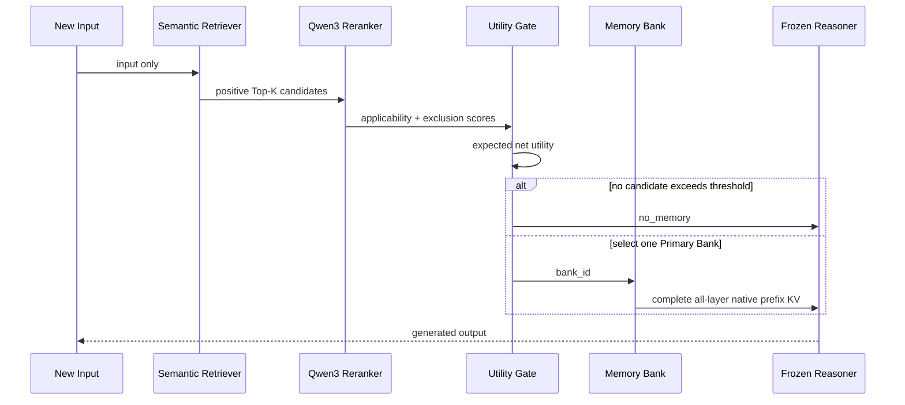

# MemGen V5：基于对照经验归纳与效用感知检索的潜在记忆系统

## 摘要

本文研究参数冻结的小型语言模型如何从历史求解轨迹中归纳可迁移经验，并在不进行参数更新的条件下利用这些经验改善后续推理。已有 V4.3 实验表明，将完整记忆文本离线编译为原生前缀键值缓存（native prefix key-value cache, native prefix KV），能够在最终准确率上复现可见文本记忆的总体收益；与此同时，实验亦揭示了显著的双向效应：记忆既能修复基线错误，也会破坏原本正确的解答。因此，当前瓶颈不再是记忆能否影响模型，而是如何构造具有清晰适用边界的高质量记忆，以及如何仅依据当前输入选择具有正期望效用的记忆。

为此，MemGen V5 提出一个由三个阶段组成的经验记忆框架。首先，在训练划分上对冻结推理模型进行多次采样，并通过同一输入上的成功—失败轨迹对照提取最小可迁移经验单元。其次，使用本地教师模型按共同求解方法对经验进行语义归并，构造带有正向适用条件、排除条件、操作步骤和验证规则的 Memory Card，并将合格卡片编译为全层 native prefix KV。最后，在验证划分上通过语义召回、排除条件感知重排和配对候选执行估计记忆的条件效用，学习带有弃权机制的题目级选择策略。测试阶段冻结所有 Bank、索引、模型权重与阈值，每个输入至多选择一张 Primary Memory Card，亦可选择不使用记忆。

本文档系统整理 V4.3 的实验证据、V5 的问题定义、方法设计、评估协议和待验证假设。除明确标注的已有实验结果外，V5 的构造与选择改进仍属于需要在服务器端完整实验中检验的方法假设。

**关键词：** 经验记忆；冻结语言模型；对照经验归纳；记忆检索；原生前缀 KV；效用估计；选择性预测

---

## 1. 问题定义与研究范围

### 1.1 研究问题

给定参数冻结的推理模型 $f_\theta$ 与相互隔离的数据划分

$$
\mathcal{D}_{\mathrm{train}},\quad
\mathcal{D}_{\mathrm{valid}},\quad
\mathcal{D}_{\mathrm{test}},
$$

本文旨在从训练集上的历史求解 Episode 中构造记忆库

$$
\mathcal{B}=\{B_1,B_2,\ldots,B_N\},
$$

并学习仅依赖输入 $x$ 的选择策略

$$
\pi_\phi(x)\in\{\varnothing,1,2,\ldots,N\},
$$

其中 $\varnothing$ 表示 `no_memory`。若选择 $B_i$，系统加载其离线编译的 native prefix KV，并由同一个冻结模型 $f_\theta$ 完成推理。测试集不得参与 Memory Card 构造、Bank 筛除、Top-K 配置、效用模型拟合或阈值选择。

该问题包含三个相互关联但应当独立验证的子问题：

1. **经验归纳（experience induction）**：何种历史差异能够形成跨输入迁移的操作性知识，而非对单一题目的复述？
2. **记忆选择（memory selection）**：在不可访问答案和未来生成轨迹的前提下，如何判断某张 Memory Card 对当前输入是否适用且有益？
3. **记忆消费（memory consumption）**：如何在冻结模型参数的前提下，使记忆稳定参与问题表征与推理规划？

V4.3 的实验已经将第三个子问题收敛到 native prefix KV。V5 因而主要研究前两个子问题，即：

> 如何从历史 Episode 中构造具有明确输入适用边界的高质量 Memory Bank，并仅依据新输入选择一张对冻结 Reasoner 具有正条件期望效用的 Memory Card？

### 1.2 优化目标

对输入 $x$ 和候选 Bank $B_i$，记忆的样本级效用定义为

$$
u(x,B_i)=
\mathbb{1}[c_i(x)=1\land c_0(x)=0]
-
\mathbb{1}[c_i(x)=0\land c_0(x)=1],
$$

其中 $c_0(x)$ 表示无记忆基线是否正确，$c_i(x)$ 表示消费 $B_i$ 后是否正确。第一项对应 **Gain**，第二项对应 **Harm**。Selector 的目标不是最大化语义相关性，而是在允许弃权的动作空间中最大化期望净效用：

$$
\max_{\pi_\phi}
\;\mathbb{E}_{x}
\left[
u\!\left(x,B_{\pi_\phi(x)}\right)
-\lambda C\!\left(x,B_{\pi_\phi(x)}\right)
\right],
$$

其中 $C(\cdot)$ 表示生成长度、KV 显存占用或额外推理开销；选择 $\varnothing$ 时，效用与额外记忆成本均定义为零。当前主要实验以准确率和 $\mathrm{Gain}-\mathrm{Harm}$ 为核心指标，计算成本作为独立指标报告，暂不在训练目标中固定 $\lambda$。

### 1.3 方法贡献

MemGen V5 的方法贡献可概括为：

1. **基于同题对照的经验归纳**：从同一输入的成功与不同类型失败轨迹中提取最小可执行差异，降低题目内容与经验方法之间的混淆。
2. **方法中心的证据归并**：将向量召回用于候选生成，将教师模型用于语义关系判定，将程序用于身份、覆盖与审计，从而避免让生成模型承担精确集合 bookkeeping。
3. **检索元数据与记忆载荷解耦**：正向 Selector Key、排除条件和完整 Memory Payload 分别服务于召回、适用性判断和 Reasoner 消费。
4. **效用感知的选择与弃权**：通过验证集上对基线和候选 Bank 的配对执行直接监督 Gain/Harm，而非将相似度或 Reranker 分数误解释为成功概率。
5. **原生前缀 KV 消费**：将完整 Card 离线编译为冻结 Reasoner 的全层 KV，使经验从推理开始即参与问题表征，同时避免在线重复编码 Card。

### 1.4 主要符号

| 符号 | 含义 |
|---|---|
| $f_\theta$ | 参数冻结的目标 Reasoner |
| $g_T$ | 仅在离线构造阶段使用的教师模型 Qwen3-32B |
| $x,y$ | 任务输入与 Reasoner 输出 |
| $E$ | 包含输入、输出、结果和生成元数据的 Episode |
| $C=(x,y^+,y^-)$ | 同一输入上的成功—失败 Contrast |
| $A$ | 从 Contrast 提取的 Experience Atom |
| $B_i$ | 第 $i$ 张 Primary Memory Card 及其编译产物 |
| $k_i^+,e_i,m_i$ | Bank 的正向检索 key、排除条件与完整记忆载荷 |
| $K_i^{(l)},V_i^{(l)}$ | Bank 在第 $l$ 个 Transformer 层的前缀 KV |
| $s_{sem},s_{app}$ | 语义召回分数与适用性重排分数 |
| $u,\hat u$ | 观测到的样本级效用与模型预测效用 |
| $\tau$ | 选择器的弃权阈值 |
| $\pi_\phi$ | 冻结后用于在线推理的题目级选择策略 |

---

## 2. 实证动机：V4.3 的结果与诊断

### 2.1 从可见文本到潜在记忆

将经验文本直接附加到 prompt 可以使模型读取外部经验，但会增加在线编码开销，并使经验与任务输入共同占据可见文本空间。本文采用另一种表征方式：将完整 Memory Card 离线编译为 Reasoner 自身的注意力缓存，并在推理时直接加载。该设计具有以下性质：

- 不修改 Reasoner 参数；
- 不需要在线重新编码 Memory Card；
- 记忆在所有注意力层中以原生前缀位置存在；
- 在线效果与“把相同记忆文本放在题目前面”具有明确对应关系；
- 可以独立研究记忆构造、选择与消费，而不把它们混成一个变量。

这里的 KV 不是人工定义的数据库 `key → value`。Transformer 中每一层的 attention K 和 V 都由同一份完整 Memory Card 经过冻结 Reasoner 前向计算得到。题目级检索使用的 Selector Key 是另一套元数据，两者必须严格区分。

### 2.2 V4.3 已经证明 native prefix KV 能承载有效经验

在 76 道诊断题上的文本/KV 等价实验中：

| 分支 | 准确率 | 正确数 | Gain | Harm |
|---|---:|---:|---:|---:|
| 无记忆 Baseline | 56.58% | 43/76 | 0 | 0 |
| 可见文本记忆 | 68.42% | 52/76 | 20 | 11 |
| Native Prefix KV | 68.42% | 52/76 | 19 | 10 |
| 旧 Frozen Side KV | 56.58% | 43/76 | 4 | 4 |

上述结果表明：

1. 当前 Memory Card 文本确实能够改变模型行为并提高准确率；
2. 将同一文本编译为原生 prefix KV 后，准确率收益仍然存在；
3. 旧的 side-attention 注入没有复现文本记忆的效果；
4. 后续应固定 native prefix KV，把研究资源投入 Bank 构造与 Selector。

由于不同分支的生成轨迹并非逐 token 完全一致，本文不主张数值层面的严格轨迹等价；然而，以最终任务准确率为核心指标，native prefix KV 已达到与可见文本记忆一致的总体性能。

### 2.3 延迟注入与 entropy gate 的负向证据

在相同 100 道诊断题上比较不同记忆消费时机：

| 方法 | 准确率 | Gain | Harm | 使用记忆数 |
|---|---:|---:|---:|---:|
| Baseline | 53% | 0 | 0 | 0 |
| Native Prefix KV | 61% | 19 | 11 | 68 |
| Prompt End 注入 | 32% | 5 | 26 | 68 |
| Entropy Gate 延迟消费 | 52% | 3 | 4 | 25 |

随后实现了“不回放历史、不重建已有推理链，只让未来 token 读取离线 Memory KV”的延迟方案。该方案在完整性上成立：

- 没有历史 token replay；
- 没有插入可见 token；
- 激活前轨迹完全一致；
- 第一轮读取 Memory 的注意力质量明显非零。

该方法的准确率为 54%，相对 53% baseline 仅净增 1 题，数值上明显低于从题目前生效的 native prefix KV（61%）。这一结果支持如下解释：当前 Memory Card 更接近一种**全局求解先验**，其主要作用在于参与问题表征与初始解法规划，而非在推理链已经形成后执行局部修补。

在 1,319 道官方 final-test 上，这一结论更加明确：

| 方法 | 准确率 | 正确数 | 相对 Baseline | Gain | Harm | 配对精确检验 $p$ | 平均生成 Token |
|---|---:|---:|---:|---:|---:|---:|---:|
| Baseline | 48.82% | 644 | 0 | 0 | 0 | — | 280.81 |
| 相似度选择 + Native Prefix KV | 50.04% | 660 | +1.21 个百分点 | 255 | 239 | 0.4998 | 336.34 |
| Entropy Gate + 延迟 KV | 42.68% | 563 | -6.14 个百分点 | 22 | 103 | $1.00\times10^{-13}$ | 284.66 |

Native prefix KV 相对 baseline 的 +1.21 个百分点在该测试上不具有统计显著性，因此不能据此声称正式测试性能已经得到可靠提升。其方法选择依据是：它在诊断实验中复现了可见文本记忆的总体准确率，并显著优于旧 side KV 和延迟注入；同时，255 个 Gain 与 239 个 Harm 证明其具有足够强的行为干预能力。V5 的目标正是改变这一收益—风险结构，而不是将现有 +1.21 个百分点视为最终结论。

因此 V5 明确冻结以下选择：

- 记忆在题目推理开始前进入原生 prefix；
- 不使用 entropy gate；
- 不做中途延迟注入；
- 不回放已经生成的历史；
- 暂不研究注入层压缩和 KV token 压缩。

### 2.4 核心误差形态：Gain 与 Harm 并存

在官方 final-test 中，native prefix KV 修复了 255 道 baseline 错题，同时破坏了 239 道 baseline 正确题，最终净增仅为 16 道。该结果并不意味着记忆缺乏作用；相反，它说明记忆对模型行为具有较强干预能力，但系统尚不能可靠区分：

> 现有系统能够检索语义相关的经验，但尚不能稳定判别其输入适用性与 Reasoner-specific utility。

语义相关只说明题目和 Card 讨论了相似结构，并不意味着：

- 题目一定需要这条方法；
- Card 的边界与题目完全一致；
- 小型 Reasoner 能正确理解这条 Card；
- 原本正确的解法不会被经验干扰；
- 使用经验的收益大于生成长度和错误诱导成本。

这正是 V5 引入 `Expected Utility + no_memory` 的直接动机。

### 2.5 题目级选择的有效性与局限性

在 100 道开发评估题上：

| Selector | 准确率 | Gain | Harm | 使用记忆数 |
|---|---:|---:|---:|---:|
| 无记忆 | 53% | 0 | 0 | 0 |
| 语义相似度 | 61% | 19 | 11 | 68 |
| 学习型 Selector | 61% | 20 | 12 | 64 |
| 训练集固定最佳 Bank | 67% | 28 | 14 | 100 |
| Oracle Best Bank | 95% | — | — | — |

上述结果表明：

1. 题目级选择确实高于无记忆；
2. 简单学习型 Selector 没有超过相似度方法；
3. 固定 Bank 表现较好，说明部分 Card 可能是一种通用求解先验；
4. Oracle 上限很高，Bank 中存在大量尚未被 Selector 捕获的潜在收益；
5. Selector 的困难不只是“找到相似题”，而是预测某张 Card 对当前 Reasoner 的因果效用。

进一步的 Qwen3-Reranker-8B 实验中，`semantic top-3 + rerank` 在 tune 上仍为 65%，与结构相似度 top-1 的 65% 相同。Reranker 改变了排序，但没有提高最终正确率。因此 V5 不把 reranker 分数当作成功概率，而只把它作为“输入适用性”特征，最终仍需通过 valid 上真实的 gain/harm 拟合效用和弃用阈值。

### 2.6 Bank 构造流程的结构性缺陷

旧构造流程已经能够从 6,726 道 train 输入中产生 5,842 条 Evidence，并形成 269 个候选 Group/Card，但暴露出几个结构问题：

- 每题只选一组成功/失败轨迹，容易丢掉同题的其他失败机制；
- 成功、失败、格式错误和截断之间的边界不够统一；
- 静态关键词、数字、实体检查可能错误拒绝有效经验；
- 教师模型被要求复制完整 Evidence ID，频繁出现覆盖、重复和伪造 ID 错误；
- 顺序式 Group 合并和 Card 迭代会产生处理顺序依赖；
- 单题或极少样本支持的 Card 也可能被判为 Primary；
- Selector 使用的 key 与完整 Card 的内容边界不一致；
- GSM8K 专用 prompt 难以扩展到代码、科学问答和动态任务。

V5 因此不只是替换一个 Selector，而是重新定义从 Episode 到 Bank 的整条信息链。

---

## 3. V5 的核心设计原则

### 3.1 三种对象必须分离

V5 明确区分：

```text
Selector Query = 当前新输入
Selector Key   = 仅从输入即可判断的适用性元数据
Memory Value   = 完整 Memory Card 编译得到的 Native Prefix KV
```

Transformer 的 attention K/V 不是人工拆分的“检索键—数据库值”。完整卡片的所有字段共同产生每一层 K/V。

### 3.2 Selector 只能使用输入可观察信息

题目级 Selector 运行时还没有模型推理轨迹，因此 key 不能包含：

- “当模型算错时”；
- “当中间结果不一致时”；
- “如果当前推理遗漏了某一步”；
- 需要看到生成状态才能判断的 runtime trigger。

Selector 使用的元数据只能来源于输入可观察信息。其中，正向 Selector Key 包含：

- 任务目标；
- 问题结构；
- 输入中的显式线索；
- 所需操作类型。

同样能够从输入判断的反向边界单独存入 `exclusions`，不与正向 key 共同编码。

### 3.3 正向条件和排除条件不能混入同一个 Embedding

如果把 `when + not_when` 直接拼接后做 cosine similarity，当题目恰好符合 `not_when` 时，词面相似反而可能提高该 Bank 的召回分数。

因此 V5 使用：

```text
正向 applicability → Embedding Top-K 召回
exclusions          → Top-K 后交给 Reranker 判断
```

即：

$$
K_s^+(B)=\{\text{goal, structure, cues, operation}\}
$$

$$
K_s^-(B)=\{\text{exclusions}\}
$$

第一阶段只编码 $K_s^+(B)$，不会执行 $\operatorname{Embed}(K_s^+ + K_s^-)$。

### 3.4 只使用 Primary Bank，允许 no_memory

记忆不是必须消费的资源。线上动作空间为：

$$
\mathcal{A}(q)=\{\text{no\_memory}\}\cup\mathcal{B}_{primary}
$$

每道题最多选择一张 Primary Bank。如果所有候选的预测净收益都不够高，则选择 `no_memory`。

### 3.5 通用记忆核心只消费 Episode

V5 将不同任务统一为：

$$
E=(\text{input},\text{output},\text{outcome})
$$

例如：

- GSM8K：`input=题目`，`output=推理与答案`；
- KodCode：`input=代码需求`，`output=程序`；
- GPQA：`input=问题与选项`，`output=推理与选择`；
- 动态任务：`input=初始目标`，`output=交互轨迹`。

不同任务仍然需要自己的数据读取、prompt 和 verifier，因为“答案是否正确”本身就是任务定义的一部分；但它们不需要分别实现 Memory Atom、Grouping、Card、Selector 和 KV 编译，也不需要各写一套记忆 prompt。

当前代码只注册了 GSM8K Task Protocol。跨领域统一的是 V5 记忆层；未来接入 KodCode 等任务时，只增加任务执行协议，不修改记忆 schema 和教师任务。

---

## 4. 方法概述

MemGen V5 由三个在数据和功能上相互隔离的阶段构成：训练集上的离线记忆归纳、验证集上的选择器校准，以及测试集上的冻结在线推理。图 1 给出完整信息流。图中实线表示单次阶段内的数据变换，虚线表示跨阶段只读复用的冻结产物；黄色节点为教师模型参与的语义归纳操作，蓝色节点为冻结 Reasoner 的计算，绿色节点为持久化记忆产物，紫色节点为在验证集上校准后冻结的选择策略。



**图 1　MemGen V5 总体方法。** 阶段 I 仅使用 $\mathcal{D}_{\mathrm{train}}$ 构造 Memory Bank；阶段 II 仅使用 $\mathcal{D}_{\mathrm{valid}}$ 测量候选 Bank 相对无记忆基线的配对效用，并校准选择与弃权策略；阶段 III 在 $\mathcal{D}_{\mathrm{test}}$ 或真实在线输入上执行完全冻结的策略。Qwen3-32B 仅参与离线语义归纳，不参与正式在线推理。测试标签既不进入检索与选择，也不用于任何形式的后验调参。

形式上，一张合格 Bank 表示为

$$
B_i=\left(k_i^{+},e_i,m_i,\{K_i^{(l)},V_i^{(l)}\}_{l=1}^{L}\right),
$$

其中 $k_i^{+}$ 是只包含输入可观察正向线索的 Selector Key，$e_i$ 是独立保存的排除条件，$m_i$ 是完整 Memory Payload，$\{K_i^{(l)},V_i^{(l)}\}_{l=1}^{L}$ 是由完整 Card 经冻结 Reasoner 编译得到的全层原生前缀 KV。该表示明确区分了用于候选召回的信息、用于适用性判定的信息与实际被模型消费的潜在记忆。

整个系统遵循如下数据使用协议：

| 数据划分 | 用途 |
|---|---|
| Train | Rollout、经验提取、分组、Card 构造与 KV 编译 |
| Valid | Selector 候选效用测量、模型拟合与阈值校准 |
| Test | 冻结系统的最终评估 |

Test 不参与 Card 构造、Bank 删除、Top-K 选择、阈值调整或 Selector 训练。

---

## 5. 阶段 A：Reasoner Rollout 采集

### 5.1 采样策略

每个 train 输入固定生成：

```text
1 条 greedy
7 条 stochastic sampling
```

采样配置：

```yaml
temperature: 0.8
top_p: 0.95
top_k: 0
maximum_completion_tokens: 1024
```

Rollout Reasoner 当前为冻结的 `Qwen/Qwen2.5-1.5B-Instruct`。教师 Qwen3-32B 不参与该阶段。

### 5.2 Episode Schema

```json
{
  "episode_id": "episode-...",
  "input_id": "gsm8k-train-...",
  "input": "...",
  "output": "...",
  "generation": {
    "index": 0,
    "sampling": false,
    "seed": 123,
    "token_count": 256,
    "stop_reason": "eos",
    "truncated": false
  },
  "outcome": {
    "reward": 1.0,
    "answer_correct": true,
    "format_correct": true,
    "truncated": false,
    "details": {}
  },
  "provenance": {
    "source_split": "train",
    "input_sha256": "..."
  }
}
```

Episode 必须绑定：

- 数据集 revision；
- Reasoner 精确 revision；
- tokenizer 和 prompt 实现；
- sampling seed；
- 生成参数；
- 代码和环境 hash。

该阶段的完成条件是：每个选定 train 输入恰好有 8 条经过验证的 Episode。

---

## 6. 阶段 B1：轨迹审查与对照构造

### 6.1 成功轨迹

成功必须同时满足：

```text
任务 Verifier 通过
AND 输出格式正确
AND 未被长度截断
AND 教师判断过程正确
```

教师允许与参考答案不同但逻辑正确的解法。最终答案正确但过程包含关键错误的轨迹不能作为成功参考。

### 6.2 失败轨迹

非截断轨迹只要满足任意一项即为失败：

```text
answer_error
format_error
process_error
```

一条轨迹可以同时包含多个失败类型。

### 6.3 截断轨迹

达到 1,024 token 上限或以长度限制停止的轨迹被标为 `truncated`。截断既不表示完整解法错误，也不能证明它会成功，因此：

```text
eligible_as_success = false
eligible_as_failure = false
```

截断只进入生成长度和覆盖率统计。

### 6.4 同题对照选择

对每个输入：

1. 排除截断和 uncertain 轨迹；
2. 选择一条可靠成功轨迹；
3. 每种主要失败模式最多选择一条代表轨迹；
4. 每题最多形成 3 个 Contrast；
5. 优先使用 `greedy failure + sampled success`。

Contrast 表示为：

$$
C=(x,y^+,y^-,f,r^+,r^-)
$$

其中 $x$ 是输入，$y^+$ 和 $y^-$ 是较好与较差输出，$f$ 是失败类型，$r^+,r^-$ 是过程审查。

全成功、全失败、只有截断或没有可靠成功参考的输入暂不产生可迁移 Contrast。

---

## 7. 阶段 B2：Experience Atom 提取

Qwen3-32B 比较同一输入上的成功和失败输出，提取导致结果差异的最小可执行因素。

### 7.1 Atom Schema

```json
{
  "applicability": {
    "task_goal": "...",
    "problem_structure": "...",
    "observable_cues": ["..."],
    "required_operation": "..."
  },
  "experience": {
    "do": ["..."],
    "avoid": ["..."],
    "why": "...",
    "verify": ["..."],
    "runtime_limits": ["..."]
  },
  "exclusions_from_input": ["..."],
  "failure_mechanism": "...",
  "teacher_assessment": {
    "transferable": true,
    "confidence": 0.91,
    "reason": "..."
  }
}
```

### 7.2 泛化原则

教师需要抽象“操作与必要条件”，而不是简单删除名词和数字。

有效经验示例：

```text
当多个量共享同一个乘法尺度时，先显式建立共同尺度变量，再代入具体量；
最后把结果代回每个比例关系进行验证。
```

无效经验示例：

```text
当 John 有 12 个苹果时先设 x。
```

也不能过度概括成：

```text
仔细阅读题目，逐步推理并检查答案。
```

一条 Atom 必须同时包含：

- 可执行操作；
- 失败机制；
- 输入可观察的适用条件；
- 输入可观察的排除条件；
- 验证方式；
- 运行时限制。

如果成功与失败的差别只是写作风格、随机采样噪声或原题特有细节，则 `transferable=false`。

### 7.3 结构验证与语义验证分工

程序只验证：

- JSON 和字段类型；
- 枚举值；
- ID 范围和去重；
- 数值合法性；
- 请求覆盖完整性。

程序不再通过关键词、数字、实体或文本重叠规则判断经验好坏。是否针对单题、是否过度概括、是否可迁移由教师的语义审查负责。

---

## 8. 阶段 B3：按共同方法进行语义分组

分组目标不是把“题目相似”的 Atom 放在一起，而是判断：

> 多个 Atom 是否描述了在兼容适用条件下相同的可执行求解方法。

合并需要同时满足：

```text
核心操作相同或能够统一
AND applicability 兼容
AND exclusions 不冲突
AND failure mechanism 可以由共同方法解释
```

### 8.1 分组算法

1. **局部 Partition**：Qwen3-32B 对小批量 Atom 按方法分组；
2. **候选召回**：冻结 Reasoner Encoder 对 Group 摘要编码，为每个 Group 检索 Top-K 近邻；
3. **Pair Judgment**：Qwen3-32B 对候选对输出 `same_method / related_but_different / different`；
4. **方法图**：只有 `same_method`、适用条件兼容且不存在 exclusion 冲突的 pair 才建立边；
5. **Cluster Edge Audit**：教师检查连通分量中的候选边，阻断链式错误合并；
6. **Connected Components**：程序在审核后的边上计算最终 Group。

Embedding 只决定哪些 pair 值得交给教师，不能直接决定最终分组。

### 8.2 程序负责身份与覆盖

教师只操作 `A01/P01/E01` 之类的局部短 ID。正式 Atom ID、Group ID、成员覆盖与去重均由程序维护。这样避免让大模型承担不擅长的长哈希复制和集合 bookkeeping。

如果局部 Partition 多次违反协议，程序保守地保存 singleton，并标记 `protocol_fallback=true`。这类 Group 可以被审计，但不能晋升 Primary。

---

## 9. 阶段 B4：Memory Card 构造

### 9.1 平衡归并

旧流程按 Evidence 批次不断覆盖上一版 Card，容易遗忘早期边界。V5 使用平衡式归并：

```text
Atoms
├─ Leaf Summary A
├─ Leaf Summary B
├─ Leaf Summary C
└─ Leaf Summary D

A + B → Summary AB
C + D → Summary CD
AB + CD → Final Group Summary
Final Group Summary → Memory Card
```

每层归并都必须保留：

- 共同方法；
- 必要适用条件；
- exclusions；
- 失败机制；
- 推荐操作；
- avoid；
- verification；
- runtime limits。

### 9.2 Card Schema

```json
{
  "selector_key": {
    "task_goal": "...",
    "problem_structure": "...",
    "observable_cues": ["..."],
    "required_operation": "...",
    "exclusions_from_input": ["..."]
  },
  "memory_payload": {
    "applicability_summary": "...",
    "method": ["..."],
    "avoid": ["..."],
    "rationale": "...",
    "verification": ["..."],
    "runtime_limits": ["..."]
  }
}
```

`selector_key` 服务于题目级选择，`memory_payload` 服务于 Reasoner 推理。Card 序列化时两部分都会进入完整记忆文本，使 Reasoner 同时知道方法和使用边界。

### 9.3 Primary 资格

一张 Card 只有满足以下条件才成为 Primary：

```yaml
minimum_distinct_inputs: 3
group_coherent: true
card_executable: true
selector_key_input_observable: true
contradiction_free: true
semantic_critic: primary
protocol_fallback: false
```

支持不足或边界仍不确定的候选进入 Conditional；错误、不一致或构造协议失败的候选进入 Reject。在线只加载 Primary。

Primary 表示“有足够构造证据且语义上合格”，不表示“已经证明能提高下游准确率”。下游效用需要在 valid 上单独测量。

---

## 10. 完整 Card 编译为 Native Prefix KV

### 10.1 Card 序列化

完整 Card 使用稳定模板：

```text
Applicable when:
- ...

Recommended method:
- ...

Avoid:
- ...

Why:
- ...

Verify:
- ...

Limits:
- ...
```

### 10.2 编译

使用与在线推理完全一致的 Reasoner、tokenizer、chat template、dtype、attention backend 和 revision，对 Card 做一次离线前向：

$$
\{K_B^l,V_B^l\}_{l=1}^{L}
=
\operatorname{ReasonerPrefix}(\operatorname{Tokenize}(\text{Card}_B))
$$

缓存保存全部层，并绑定：

- `bank_id`；
- Card record hash；
- profile hash；
- prefix token IDs；
- tensor file hash；
- 模型与 tokenizer revision；
- 原生绝对位置策略。

在线消费时，Memory token 占据位置 `0...M-1`，题目从位置 `M` 开始。题目 prefill 可以注意到 Memory KV，效果对应于完整 Card 位于题目前缀。

---

## 11. V5 Selector

V5 将 Selector 分成三个不同目标，避免把“相似”“适用”“有收益”混为一谈。

### 11.1 第一层：正向语义召回

对每个 Bank 构造正向检索文本：

```text
Task goal: ...
Problem structure: ...
Observable cues: ...
Required operation: ...
```

当前使用冻结 Reasoner 的平均 hidden state 作为归一化向量，计算：

$$
s_{sem}(q,B)=\cos(E(q),E(K_s^+(B)))
$$

默认召回 Top-5。该阶段不读取 exclusions，不读取 Memory Payload，也不读取任何答案或生成结果。

### 11.2 第二层：排除条件感知的适用性 Reranker

Qwen3-Reranker-8B 读取：

```text
当前输入
正向 Selector Key
Excluded when: ...
```

它只判断这张 Card 是否适用于当前输入，不解题，不预测最终答案。输出的 yes/no logit 转换为 applicability score：

$$
s_{app}(q,B)=\sigma(z_{yes}-z_{no})
$$

该分数仍然不是“Reasoner 使用后会答对”的概率。

### 11.3 第三层：Expected Utility 与 Abstention

在 valid 上，对于每个问题，先在不知道结果的情况下冻结 Top-K 候选和 reranker 分数，然后运行：

```text
baseline
每个 Top-K candidate Bank
```

定义候选效用：

$$
u(q,B)=
\mathbb{1}[\text{memory correct, baseline wrong}]
-
\mathbb{1}[\text{memory wrong, baseline correct}]
$$

即：

| Baseline | Memory | Utility |
|---|---|---:|
| 错 | 对 | +1 |
| 对 | 错 | -1 |
| 对 | 对 | 0 |
| 错 | 错 | 0 |

当前 Ridge Utility Model 使用以下特征：

```text
bias
semantic similarity
reranker applicability
semantic top margin
log(1 + Bank support count)
semantic × reranker
```

模型估计：

$$
\hat u(q,B)=w^\top\phi(q,B)
$$

最终选择：

$$
B^*=\arg\max_{B\in TopK(q)}\hat u(q,B)
$$

如果：

$$
\hat u(q,B^*)\le\tau
$$

则返回 `no_memory`。阈值 $\tau$ 只在 valid 上确定。

为了减少 valid 过拟合，系统保存五折 out-of-fold 指标，并把 OOF 结果与全 valid 重拟合后的 in-sample 结果分开报告。最终在线 policy 使用全部 valid 拟合的权重和阈值，但有效性判断优先参考 OOF。

---

## 12. 在线推理协议

在线阶段不访问标准答案，也不调用 Qwen3-32B 教师。



**图 2　单样本在线推理时序。** 在线模块仅访问输入、冻结检索索引、冻结 Reranker、冻结 Utility Model 及预编译 KV。教师模型、训练 Evidence、验证标签和测试标签均不属于在线依赖。若最高预测效用未超过阈值 $\tau$，系统退化为原始无记忆 Reasoner；否则只加载一张 Primary Bank。

在线约束为：

- 一道题最多选择一张 Bank；
- Top-K 只用于候选选择，不会同时消费多张 Card；
- 允许 `no_memory`；
- 只使用 Primary；
- Memory 在题目 prefill 前加载；
- Reasoner 参数冻结；
- KV 不在线改写；
- 不使用 entropy gate；
- 不进行历史 replay；
- 不在推理中途切换 Bank。

---

## 13. 评估设计

### 13.1 必须报告的系统分支

Valid 至少比较：

```text
no_memory
semantic_top1_forced
reranker_top1_forced
v5_expected_utility_selector
```

诊断阶段还可以报告 Candidate Oracle，用于区分“候选召回失败”和“候选排序/弃用失败”。

Test 只运行预先冻结的正式策略：

```text
no_memory
frozen V5 selector + native prefix KV
```

### 13.2 准确率指标

```text
accuracy
correct / count
accuracy_delta
gain
harm
net_gain = gain - harm
paired_exact_p
memory_use_count
memory_use_rate
```

其中 gain/harm 比单独准确率更重要，因为它直接揭示记忆是在修复错误还是破坏原有正确解法。

### 13.3 Token 与计算成本

```text
generated_tokens.total
generated_tokens.mean
generated_tokens.median
generated_tokens.p90
generated_tokens.max
at_1024_token_limit_count
prefix_token_count
reranker_input_tokens
reranker_latency
reasoner_latency
```

离线 Memory Card token 不属于 completion token，但它们对应在线 KV 显存和注意力读取成本，必须单独报告。

### 13.4 Bank 构造指标

```text
Episode 数
Success / Failure / Uncertain / Truncated 数
Contrast 数及失败类型分布
Transferable Atom 数
Group 数与大小分布
Primary / Conditional / Reject 数
Primary distinct-input support
Protocol fallback 数
Card 长度分布
近重复 Card 数
每张 Bank 的选择频率与 gain/harm
```

### 13.5 问题定位矩阵

| 现象 | 更可能的问题 |
|---|---|
| Candidate Oracle 高，实际 Selector 低 | 排序或 utility/abstention 不好 |
| Candidate Oracle 也低 | Bank 内容或候选召回不好 |
| 全库存在有益 Bank，但 Top-K 没有 | Selector Key 或 embedding recall 不好 |
| 语义适用但频繁 Harm | Card 不适合小型 Reasoner，或效用模型不足 |
| 一张 Bank 被大量无关题选择 | Key 过度概括、hubness 或阈值过低 |
| 很多题所有 Bank 都无收益 | Bank 方法覆盖不足或 Card 质量不足 |
| Valid 有收益、Test 无收益 | 构造/选择过拟合 |
| Token 明显增加、准确率不升 | Card 太长或诱导过度推理 |

---

## 14. 当前固定项与研究变量

### 14.1 已固定

```yaml
reasoner_frozen: true
memory_consumption: native_prefix_kv
memory_position: before_question
all_layers: true
one_bank_per_input: true
online_tier: primary_only
history_replay: false
entropy_gate: false
delayed_injection: false
rollouts_per_train_input: 8
greedy_rollouts: 1
sampled_rollouts: 7
sample_temperature: 0.8
sample_top_p: 0.95
maximum_completion_tokens: 1024
teacher: local_qwen3_32b
```

### 14.2 当前研究变量

- Contrast 是否抓住了真正导致成败差异的方法因素；
- Experience Atom 是否具有跨题迁移性；
- 分组是否按共同方法而不是题目主题聚类；
- Card 是否足够具体，又不过度依赖原题；
- Primary 的最小支持门槛是否合理；
- 正向 Selector Key 是否覆盖有效检索线索；
- Top-K 取值；
- Reranker 是否正确识别 exclusions；
- Utility Model 是否能同时保留 gain、过滤 harm；
- Abstention threshold；
- Card 长度与小型 Reasoner 可理解性。

### 14.3 暂不研究

- Entropy/risk gate；
- 延迟 KV 注入；
- 推理中途切换 Bank；
- 多 Bank 联合消费；
- 选择具体注入层；
- KV layer/head/token 压缩；
- 在线 Card 重写；
- 在线记忆巩固与遗忘。

只有在 Bank 构造和题目级 Selector 稳定后，才有必要重新打开这些变量。

---

## 15. 实现结构与可复现性

V5 代码位于：

```text
memgen/experience/v5/
├── task.py            # Task → Generic Episode 协议
├── rollouts.py        # 1 greedy + 7 sampling
├── review.py          # 结果/过程/截断分类
├── contrasts.py       # 同题多失败模式对照
├── atoms.py           # 通用 Experience Atom
├── grouping.py        # 语义候选图与 Cluster Audit
├── cards.py           # 平衡归并、Card 与 Primary 资格
├── compilation.py     # Selector Key + Primary 编译入口
├── prefix.py          # V5 Native Prefix KV
├── selector.py        # Top-K、Utility Model、Abstention
├── calibration.py     # Valid 候选因果效用测量
├── online.py          # 在线选择与单 Bank 消费
├── evaluation.py      # 冻结 valid/test 评估
├── prompts.py         # 跨领域教师任务
├── schemas.py         # 结构协议验证
├── sources.py         # 模型、代码、环境身份绑定
├── audit.py           # 完整性审计
└── pipeline.py        # 两阶段编排
```

主要命令：

```text
scripts/build_v5_memory.py
scripts/serve_v5_teacher.py
scripts/evaluate_v5_memory.py
scripts/use_v5_memory.py
scripts/experiments/gsm8k/run_v5_memory.sh
```

V5 使用不可覆盖的 checkpoint 和产物 hash：

- 每个阶段可恢复；
- 已完成产物必须与输入 hash 一致；
- 模型、数据集、代码或运行环境变化时必须使用新输出目录；
- 教师原始请求、响应和失败 attempt 均保留；
- Test 评估绑定 Bank profile 与 Selector policy hash；
- V4.3 的冻结 prefix 实现和旧恢复 hash 不被 V5 修改。

---

## 16. 当前结论、待验证假设与有效性边界

### 16.1 已有实验支持的结论

1. 当前 Card 对小型 Reasoner 具有实质性的行为干预能力，既产生大量 Gain，也产生大量 Harm；
2. Native Prefix KV 在诊断实验中保留了可见文本记忆的总体准确率，是当前证据下最合理的消费方式；但官方 test 上的 +1.21 个百分点尚不具有统计显著性；
3. 延迟 KV 与 entropy gate 在当前设定下明显弱于题目前缀记忆，并在官方 test 上造成统计显著的性能下降；
4. 题目级语义选择高于无记忆，但 Gain 与 Harm 都很大；
5. 单纯增加 Qwen3 reranker 没有自动提高准确率；
6. 当前瓶颈集中在 Bank 内容、输入适用边界和 Reasoner-specific utility，而不是 KV 是否能够影响模型。

### 16.2 V5 尚待服务器实验验证的假设

1. 多失败模式 Contrast 会比每题单 Evidence 提供更完整的经验覆盖；
2. 输入可观察的正向 key 与独立 exclusions 会减少错误召回；
3. 至少三个不同输入支持的 Primary Card 会比 singleton/双样本 Card 更稳定；
4. 平衡归并 Card 会减少顺序遗忘和边界漂移；
5. Valid 上拟合的 Expected Utility 与 Abstention 能保留更多 gain、过滤更多 harm；
6. 同一套 Atom/Card prompt 能在 KodCode 等任务上工作，而不需要数据集专用记忆 prompt。

当前 V5 已经完成代码实现和本地纯逻辑测试，但尚未取得服务器端完整 Bank 构造与官方 test 结果。因此不能把 V5 的方法改进直接表述为准确率提升。下一步应先运行完整 GSM8K V5 流程，检查构造统计和 valid OOF，再冻结策略运行官方 test；只有在这一步通过后，才进入跨领域验证或 KV 压缩研究。

### 16.3 有效性边界

当前研究结论受到以下边界约束：

- 主要实证结果来自 GSM8K 与 `Qwen/Qwen2.5-1.5B-Instruct`，尚不能直接外推到代码生成、知识问答或更大 Reasoner；
- V4.3 的若干诊断实验复用了既有 calibration/evaluation pool，应当用于机制分析而非最终无偏性能声明；
- V5 Utility Model 的可靠性取决于 valid 集规模、Top-K 候选覆盖率与配对执行噪声，必须同时报告 OOF 指标和 Candidate Oracle；
- Qwen3-32B 同时参与过程审查、Atom 提取、方法关系判定和 Card 构造，其系统性偏差可能在多个阶段累积；
- Primary 资格仅表示构造证据充分与语义一致，不等价于对下游 Reasoner 的正效用保证；
- 当前 native prefix KV 结论针对全层、题目前缀消费，不能直接推广到层稀疏、token 压缩或推理中途注入。

---

## 17. 后续研究计划与验证顺序

为维持因果归因和测试集隔离，后续实验应按以下顺序推进：

1. **完成 GSM8K V5 Rollout**：检查每题 8 条 Episode、截断率、成功/失败覆盖；
2. **完成 Qwen3-32B 过程审查与 Atom 提取**：统计失败类型和 transferable 比例；
3. **审查 Group/Card 分布**：重点检查 singleton、小组、超大组、Primary 支持数和重复 Card；
4. **运行 Valid Top-K 全候选效用表**：分别报告 semantic、reranker 和 Candidate Oracle；
5. **检查 Utility Selector OOF**：要求 gain/harm 和 memory-use rate 同时可解释；
6. **冻结后运行官方 Test**：比较 no-memory 与 V5，不根据 test 调参；
7. **做失败归因**：区分 construction、recall、rerank、utility 与 Card-consumption 问题；
8. **跨领域复用**：接入 KodCode Task Protocol，保持 V5 memory prompt/schema/selector 不变；
9. **最后才研究压缩**：在方法有效后讨论减少 prefix token、层数或 KV 显存。

V5 的核心研究问题可以表述为：

> 能否从同一输入上的较好与较差输出中，构造出具有明确输入适用边界的可复用操作记忆，并通过只读输入的 Selector 选择一张对冻结 Reasoner 具有正期望净收益的 Memory Card？
